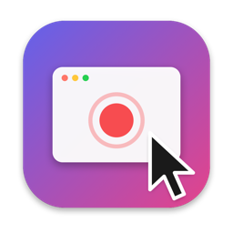

# Bjarbys skärminspelare

[](https://www.patreon.com/AndersBjarby)



A native macOS screen recorder for polished demos and tutorials. It records **data, not a
finished video**: the screen without the cursor, the microphone, system audio and camera
on separate tracks, and every mouse move and click as events. Zoom, cursor, background
and framing are added afterwards in the editor, and they stay editable.

The interface is in Swedish (*skärminspelare* means screen recorder). An English translation
is included; to have the app follow your system language instead, run
`defaults write com.brattoo.skarminspelare followSystemLanguage -bool true` and restart it.

## What it does

**Recording**
- A whole display, a window or an app through the system picker, or an area you drag out.
- A 3-2-1 countdown, then a floating panel with time, level meters, pause, stop and
  discard. It warns about a silent microphone, a disk running full and tracks that stop.
- Global shortcuts: ⌃⌥⌘R start/stop, ⌃⌥⌘P pause, ⌃⌥⌘A record an area, ⌃⌥⌘S save the
  flashback — all changeable under Settings › Keyboard Shortcuts.
- The app's own windows never end up in the recording, and on request neither do desktop icons,
  notifications or desktop widgets — without touching your desktop or system settings.
- HDR on HDR displays: 10-bit BT.2020 PQ, exported as HDR (HLG, HEVC 10-bit) or as SDR with
  white kept white.
- Audio per app: pick apps (a call, a browser, music) and each gets its own track through Core
  Audio taps, mixable and mutable in the editor; the rest of the computer audio on another.
- A teleprompter: your script scrolls at reading speed in a box near the camera, visible only
  to you.
- Flashback: keep recording in the background and save the last 1–10 minutes after the fact
  (⌃⌥⌘S), as a normal recording you can edit.
- Crash-safe: every track is its own file, written in 2-second fragments. A recording that
  is cut off is playable up to the last fragment and is recovered at the next launch.

**Editor**
- Zooms suggested from your clicks, with a spring-driven camera that keeps the cursor in
  a safe zone and looks ahead. Move them, resize them, delete them or add your own on the
  timeline.
- Optional motion blur while the camera zooms and pans, like a real camera at 1/120 s.
- The cursor is drawn back on a smoothed path, at any size, with click rings, and hides
  when it stands still.
- Gradient, solid or blurred backgrounds, padding, rounded corners, shadow, and 16:9,
  9:16, 1:1 or 4:3 output.
- Reel mode: a landscape recording fills a 9:16 (or any other) frame and the frame follows
  the pointer, with or without zoom.
- Keyboard shortcuts pressed during recording appear as a small caption ("⌘Z ×3").
- Split, delete and change the speed of parts of the recording, with undo. Trim a part by
  dragging its ends on the timeline — nothing is removed from the recording, so you can drag
  it back out — and ⌥-drag an end to stretch the part to a new speed. Drag a selected part to
  move it; Q and W trim the start and end of the part under the playhead to the playhead.
- Layers: title cards, callouts around the button you clicked, fact boxes, QR codes, free
  text anywhere, images (logos, product shots), video inserts (picture-in-picture or full
  frame, with their sound, cropped, with soft edges, at 0.25–4× speed), chapters with a banner, and extra audio
  (music ducked under speech, narration, effects).
- Transitions at the cuts (crossfade, through black, blur with a zoom punch, flash), set for
  the whole video or per cut, with the sound crossfaded too and a short fade at every cut so
  nothing clicks; fades at the start and end.
- Save a project's look (background, frame, format, cursor, camera, captions, transitions) as
  the default, and every new recording starts with it.
- Drag and resize layers directly in the preview; fact boxes and QR codes snap to a corner.
- Camera layout per part: the bubble, the camera filling the frame (an intro), side by side with
  the screen, or hidden — the change glides over half a second.
- A camera bubble in any corner, round or rounded square, with the background behind you kept,
  blurred or replaced by the film's background (Apple's person segmentation, on device).

**Speech** (with [whisper.cpp](https://github.com/ggml-org/whisper.cpp), locally)
- Transcribe the recording and edit the video by striking out words in the text. Cut words
  stay visible, struck through, and can be restored.
- Captions burned into the video, and an `.srt` file next to the export.
- Cut dead time, where nobody speaks and neither mouse nor keyboard moves, with one button.
- Lower the computer audio while you speak, level the microphone to −16 LUFS (EBU R128), and
  remove background noise with Apple's voice isolation.

**Privacy**
- Find emails, phone numbers, Swedish personal ID numbers, card numbers and API keys on
  screen (Vision OCR, locally) and blur, pixelate or cover them. The masks follow text that
  scrolls. Add your own areas too.

**Bug reports**
- A folder and a zip with `rapport.md` (what you said, the environment with the app's version,
  steps to reproduce with times), the video, a step-by-step guide and the app's system log for
  the recording. macOS redacts private log fields, but read it through before you send it.

**Polished screenshots**
- A window, an area or the whole screen on the same background, with padding and a shadow that
  follows the window's own rounded corners. Saved and copied to the clipboard.

**Step-by-step guides**
- Turn a recording into a guide: one finished image per click or keyboard shortcut, with what
  you said as the text (or "Click button «Export»" from the accessibility name). Markdown and a
  self-contained HTML file.

**An AI producer (via Claude Code)**
- Like the AI in the Generativet podcast studio: ask Claude Code to *produce* a recording
  and it cuts dead time and false starts at word pauses, sets zooms, chapters, a title card,
  callouts that circle the exact button you clicked (from the accessibility frame), fact
  boxes, QR codes and captions, optionally adds music or narration, checks everything
  against rules (including "nothing covers what is being clicked"), looks at the finished
  frames, and leaves you a delivery note. The decisions are data you can change.

**Control from agents, scripts and Shortcuts**
- An MCP server built into the app: `--mcp` gives agents such as Claude Code tools to record
  the screen, transcribe, edit (format, Reel, captions, cuts, dead time, noise, loudness,
  hiding sensitive text), render frames to look at, make a step-by-step guide, take polished
  screenshots of an app's window, make a bug report, and export.
- A URL scheme (`skarminspelare://spela-in`, `…/stoppa`, `…/paus`, `…/oppna?sokvag=…`) and
  Shortcuts actions for the app itself.

**Sharing:** upload an export to your own S3-compatible bucket (Cloudflare R2, AWS S3, MinIO,
Backblaze B2) and get the public link on the clipboard. No service in between; the secret key
lives in the keychain.

**Export:** MP4 (H.264, 1080p), MP4 (HEVC, 4K), MP4 4K HDR (HEVC 10-bit, HLG; for HDR recordings), ProRes 422, ProRes 4444 with a transparent
background (to put the polished screen on top of something else in your editor) and GIF (one
palette for the whole clip with ordered dithering, so gradients don't band).

## Measured, not assumed

- Picture and sound about 5 ms apart, measured against a flash-and-beep reference film
  played in QuickTime, after subtracting the latency the headphones report.
- Killed with `kill -9` after about 10 seconds, the files still played to 10.0 s.
- 1080p export runs at 2–3.5× real time on an Apple M5.

The numbers and how they were taken are in
[`docs/VERIFIERAD-STACK.md`](docs/VERIFIERAD-STACK.md) (in Swedish).

## Building

Requires macOS 26 or later on Apple Silicon, and Xcode 26.1 or later. No dependencies
outside Apple's frameworks.

```bash
./scripts/build.sh          # → dist/Bjarbys skärminspelare.app
./scripts/test.sh           # unit tests for RecorderKit
open Skarminspelare.xcodeproj
```

The project is signed with the author's Developer ID. For your own copy, pick your own
team under *Signing & Capabilities* in Xcode, or pass your identity and team ID to the
build script:

```bash
SKARMINSPELARE_SIGNERING="Apple Development" SKARMINSPELARE_TEAM=<your team id> ./scripts/build.sh
```

On first launch the app asks for **Screen Recording**, which is the only permission it
needs. Microphone and Camera are optional, as are **Accessibility** (lets zooms frame the
button you clicked rather than a box around the pointer) and **Input Monitoring**, which
records keyboard shortcuts so they can be shown in the video: only keys pressed with ⌘, ⌃
or ⌥, never text.

For speech, build [whisper.cpp](https://github.com/ggml-org/whisper.cpp) (its
`build/bin/whisper-cli` and `build/bin/vad-speech-segments`) and put the models in its
`models/` folder: the Silero VAD model `ggml-silero-v5.1.2.bin`, plus
[KB-Whisper](https://huggingface.co/KBLab) for Swedish or any multilingual Whisper model. The
app looks in `~/Projekt/whisper.cpp`, `~/whisper.cpp` and a few other places, or you choose the
folder.

### Using it from Claude Code

```bash
claude mcp add skarminspelare -- "/Applications/Bjarbys skärminspelare.app/Contents/MacOS/Skarminspelare" --mcp
```

Then ask for things like *"record my screen for 20 seconds while I show the settings page, cut
the dead time, make a 9:16 version with captions and export it"*. The server records with
the screen recording permission of the terminal it runs from.

## How it is put together

- `RecorderKit/` holds all the logic as a local Swift package: `Capture` (ScreenCaptureKit,
  camera), `Writing` (one `AVAssetWriter` per track on a shared clock), `Telemetry` (mouse,
  clicks, cursor images), `Project`, `Motion` (springs, cursor and camera paths), `Render`
  (one Core Image compositor on Metal for both preview and export) and `Export`.
- `RecorderKit/Privacy/` finds sensitive text and turns it into masks that follow it.
- `RecorderKit/Speech/` runs whisper.cpp, maps word times back onto the recording and builds
  the captions.
- `App/` is the SwiftUI and AppKit interface: menu bar, recording panel, area selector,
  library and editor.
- A recording is a `.bsrec` package: the raw tracks, an `events.jsonl` log and a
  `project.json` with every editing decision. See [`docs/FORMAT.md`](docs/FORMAT.md).

## Status

The recording engine, the editor, export, speech, masking of sensitive text, the flashback
buffer and control from agents are done (see [`docs/FÄRDPLAN.md`](docs/FÄRDPLAN.md)). Per-app audio
and HDR are in too. Recording at 120 fps (on ProMotion displays) delivers about 108 frames per
second on a full Retina display; exporting at 120 is in.

Built and tested on macOS 26.1 on an Apple M5 only, with the built-in camera, and with a window
that moves during recording. The editor has not yet been tried hands-on with a mouse. Transcription has been measured on synthetic
Swedish speech, not yet on a real microphone recording. There is no notarized binary release yet.

`docs/utredningar/` holds the three research reports the app was planned from, unedited.
Their claims about other products have not been checked.

## License

[MIT](LICENSE)
