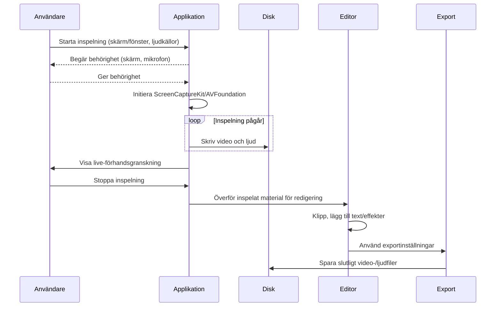
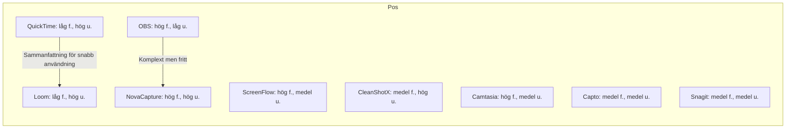
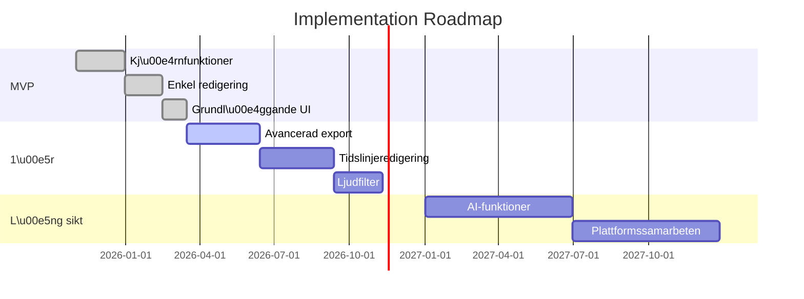

# Sammanfattning

Den ultimata skärminspelarprogramvaran för macOS bör kombinera kraftfull inspelning med lättanvänd redigering och robust prestanda. Den bör utnyttja Apples moderna API:er (t.ex. **ScreenCaptureKit**/AVFoundation) och **Metal** för hårdvaruaccelererad inspelning i full **retina-upplösning**, multi-skärm och höga bildfrekvenser (60–120 fps). Ljudinspelning ska inkludera såväl systemljud som mikrofoner (flera kanaler) med brusreducering och eko-kansellering. Stöd för moderna videoformat (H.264, HEVC/H.265, ProRes, AV1) och containrar (MP4, MOV, MKV) är ett krav. En inbyggd icke-linjär redigerare bör erbjuda tidslinjer, övergångar, text/undertexter, live-anteckningar, rituppslagningar och gröna-skärmeffekter. Exportfunktioner ska inkludera batchbearbetning, förinställningar, molnintegration, AppleScript/Shortcuts-stöd och kompatibilitet med verktyg som Final Cut/Logic/DaVinci. Gränssnittet bör vara helmacOS-nativt (inklusive Touch Bar, Kontrollcenter, Quick Look, Dela-menyn, tangentbordsgenvägar, tillgänglighets- och flerspråkstöd). Appen måste vara presterande och pålitlig (låg CPU/GPU-användning, återställ inspelningar vid krasch, hantera stora filer, synkronisering). Säkerhetsmässigt ska inspelning ske lokalt (inga molndelar), med korrekta behörighetsförfrågningar, signerad/notariserad distribution och ev. sandboxing. Monetiseringsmodeller kan vara engångslicens, prenumeration, freemium eller företagslicenser. Jämförelse med QuickTime, ScreenFlow, Camtasia, Capto, OBS, CleanShot X, Loom och Snagit visar att dagens ledare erbjuder olika kombinationer av dessa funktioner. Behoven varierar mellan tutorial-producenter, gamers, professionella screencaster, mötesdokumentation och support, vilket påverkar prioriteringen av funktioner (se tabeller nedan). Rekommendationer delas upp i kärnfunktioner (MVP), 1-års-utveckling och långsiktiga visioner. 

## Kärnfunktioner för inspelning

- **Helbild, fönster och region:** Appen bör kunna spela in hela skärmen, specifika fönster eller anpassade regioner, samt hantera flera samtidiga skärmar och multi-app-inspelning. Användaren ska enkelt välja inspelningsområde (t.ex. via en meny `Cmd+Shift+5` eller programgränssnitt).
- **Retina-stöd:** Inspelning av högupplösta Retina-skärmar kräver att appen hanterar pixel-skalning korrekt. Exempelvis måste både inspelningens fånga och AVAssetWriters inställningar konfigureras för fullupplöst utskrift. Nonstricts guider visar hur man undviker svartkanter och säkerställer maximal skärpa vid 2×-skalning. Observera att H.264 har en maxupplösning (4K, 4096×2304), så stora skärmar kan skalas ned till 4K vid inspelning.
- **Bildfrekvens:** Upp till 60 fps bör vara standard för mjuk glidning; högre fps (120–240) kan vara valbart för gaming och slow-motion. Hårdvaruaccelererad kodning (VideoToolbox/Metal) är avgörande för hög fps med låg CPU-last. Snabbare grafikchip på Apple Silicon (M-serien) möjliggör 4K/60–120fps utan synlig fördröjning.
- **Hårdvaruacceleration:** Dra nytta av Apples VideoToolbox/Metal för att snabbkodning (H.264/HEVC) sker på GPU/hårdvara. Detta minskar CPU-belastningen och möjliggör långa inspelningar utan överhettning. En djupintegrerad stöd för Apple Silicon (M1/M2/M3) och AVFoundation/ScreenCaptureKit ger maximal prestanda.
- **Låg CPU/GPU-användning:** Appen ska skala kvaliteten automatiskt och prioritera GPU-kodning för att minimera inverkan på andra program. OBS Studio är exempel på ett verktyg som utnyttjar Apples API för effektiv inspelning med minimal CPU-användning.
- **Systemljud och mikrofoner:** Inspelningen bör stödja flera ljudkällor simultant (systemljud, mikrofon, externa enheter). Idag kan inbyggda API:er fånga systemljud utan extra drivare (enligt NovaCapture använder moderna appar Apples inbyggda systemljudsinspelning, och CleanShot X kan spela in systemljud utan virtuella drivrutiner). En idealisk lösning tillåter även att välja specifika app- eller kanal-källor via en mixer (OBS kan t.ex. rikta ett programs ljud specifikt).
- **Flerspårig ljudinspelning:** Viktigt för redigering är att kunna spela in t.ex. systemljud och mikrofon på separata spår. Capto erbjuder en “Dual Audio Editor” där systemljud och mikrofon behandlas individuellt.
- **Brus/eko-reducering:** Inbyggda filter för brusdämpning och eko-kansellering i realtid förbättrar talinspelningar (särskilt vid anteckningar eller screencasts med tal). Apple’s CoreAudio kan användas för DSP-bearbetning, men det kräver ytterligare utveckling. Många användare förväntar sig dock att videoinspelningsappar inkluderar grundläggande ljudfilter.
- **Inspelningsformat:** Appen bör tillåta inspelning direkt till olika format för vidare redigering (t.ex. ProRes med transparensstöd, samt H.264/HEVC i MP4/MOV för mindre filer). För stabilitet kan inspelning initialt göras i MKV (återställning vid krasch, som OBS gör) och sedan konverteras till slutformat vid export.

## Ljudinspelning

- **System- och mikrofonljud:** Spela in både systemljud (ljud från datorn) och mikrofon samtidigt är numera möjligt lokalt på macOS utan extra ljuddrivrutiner. Appen bör erbjuda valfri mix och justerbara volymer för varje ljudkälla.
- **Flerkanaligt ljud:** För professionella ändamål kan flerkanaliga inspelningar vara relevanta (t.ex. spel med flera ljudeffekter, eller podcasts). Appen bör därför kunna hantera flera in- och utkanaler (t.ex. stereo + mic).
- **Separata spår:** Inspelning till olika ljudspår ger flexibilitet i efterbearbetning (t.ex. separera tal från bakgrundsmusik). Exempel: Capto låter användaren redigera system- och mikrofonlyd var för sig.
- **Brusreducering/eko-kansellering:** Real­tidsfilter kan reducera mikrofonbrus och eko (viktigt vid inspelning med intern mic eller via Bluetooth-hörlurar). Appen kan erbjuda en “Clean Audio”-funktion som standard.
- **Ljudrutning:** Avancerade användare kan vilja dirigera ljud via virtuella enheter (t.ex. loopback-drivrutiner som BlackHole eller Loopback). Appen kan ha stöd eller rekommendationer för detta, men själva appen bör minimera beroenden (modern API som ScreenCaptureKit kan ibland injicera ljudström utan extern drivrutin).
- **Nivåreglering:** Automatisk normalisering eller visning av ljudnivåer under inspelning hjälper användaren undvika klippning. Tydliga nivåmätare och möjlighet att finjustera mikrofonnivå är önskvärt.

## Videoformat & kodekar

- **H.264/AVC:** Standardkodningen för högkompatibla MP4-filer. Erbjud hög kvalitet vid måttlig filstorlek. Använd som grundprofil för kompatibilitet (baslinje för de flesta plattformar).
- **HEVC/H.265:** Erbjud högre komprimering (halverad filstorlek för samma kvalitet) och stöd för 10-bitar och högre upplösningar. Viktigt för 4K/60fps-inspelning; stöds nativt på modern hårdvara (särskilt Apple Silicon). Bör finnas som alternativ, men med varning om kompatibilitet.
- **ProRes:** Kodning med minimal komprimering för maximal kvalitet och edit-friendly filstruktur. Ska finnas som exportalternativ, särskilt för professionella arbetsflöden. ProRes har stöd i Apple-ekosystemet (Final Cut, Logic) och behåller färg/detalj för efterbearbetning.
- **AV1:** Ny öppen codec med ännu bättre komprimering än HEVC. Värd att inkludera för framtidssäkrad inspelning/streaming, om hårdvarustöd (VideoToolbox) tillåter det.
- **Containrar:** MP4 och MOV är de vanligaste för video (MP4 är mer generiskt), MKV kan användas temporärt för inspelning (eftersom det är robust mot krascher). Export bör stöda åtminstone MP4, MOV och MKV (med val av kodek per container).
- **Auditformat:** Inbyggd export till MP3/WAV/FLAC för bara ljudspåret kan vara användbart för podcaster och ljudanteckningar.
- **Bildformat:** För stillbildsfångst (skärmdumpar) stöder moderna appar PNG, JPEG, TIFF osv. (ex. Capto har inbyggda bildformat).
- **Presets:** Förinställningar (t.ex. “YouTube 1080p H.264”, “ProRes 422 4K”) underlättar för användare. Konkurrenter som ScreenFlow erbjuder en rad färdiga inställningar för snabb export.

## Redigering & annotering

- **Tidslinjebaserad editor:** Ett icke-linjärt redigeringsläge (NLE) med flera spår är idealiskt. Detta bör inkludera klippning (trim, klipp, dela), ordningsändring och multispårsljud.
- **Övergångar och filter:** Standardövergångar (crossfade, dip to color, wipe) och videoeffekter (färgkorrigering, nyansändring) höjer produktionsvärdet. ScreenFlow och Camtasia erbjuder stora bibliotek av övergångar och effekter.
- **Text och bildtexter:** Inbyggd stöd för underrubriker/textrutor. Både ScreenFlow och Capto har funktioner för att lägga till text och bildtexter. ScreenFlow har till och med inbyggd captions-editor.
- **Live-anteckningar/ritverktyg:** Möjlighet att rita med pennan eller peka ut detaljer medan inspelningen pågår (eller efteråt i redigering) är värdefullt för tutorials. Skärminspelningsappar som ScreenFlow och Capto inkluderar ritverktyg för direktanteckningar (pilar, former, text).
- **Zoom/Pan:** Automatiskt följ-kurser (AI-zoom) eller manuell zoom-in för att framhäva delar av skärmen är eftertraktat. Modern mjukvara (som NovaCapture) kan till och med erbjuda AI-styrd kamerazoom baserat på musrörelser.
- **Green screen (chroma key):** För inspelning med webbkamera bör appen stödja bakgrundsborttagning (grön skärm eller mjuk keying) för att integrera personer i skärminspelningen. Även Capto och Loom har grundläggande webcam-overlay-funktioner, men avancerat chroma-key är ofta en pro-funktion.
- **Storyboard och mallar:** För tutorial-serier kan mallar för titelbilder, kapitelindelningar eller markörer (Scene marker) spara tid. Exempelvis nämner ScreenFlow “styles & templates” för videosekvenser.
- **Multimedia-inkludering:** Möjlighet att importera extern media (bilder, videoklipp, ljudspår) i tidslinjen är nödvändigt för professionell redigering. ScreenFlow inkluderar till och med ett inbyggt arkiv med stockbilder, videor och ljud (mot prenumeration).

## Export & arbetsflöde

- **Batch-export:** Stöd för att rendera flera projekt samtidigt eller köa exportjobb. Och möjligheten att snabbt göra omrenderingar med nya inställningar.
- **Förinställningar:** Spara egna exportprofiler (t.ex. olika bitrate-upplösningar, kodningar) för olika plattformar (YouTube, mobil, webb). ScreenFlow erbjuder flera förinställningar (inkl. ProRes, MP4).
- **Molnintegration:** Nativa exportmöjligheter till molntjänster (t.ex. Dropbox, Google Drive) eller videoplattformar (YouTube, Vimeo, etc.) från appen. Loom visar hur sömlös delning till molnet kan vara för asynkront arbete, men nackdelen är kvalitet och integritet. Vårt fokus är lokal export, men smidig upload bör erbjudas.
- **Plugin/API:** Ett system för tredjepartsintegration (plugin eller API) öppnar för specialfunktioner (t.ex. automatiserade videoeffekter, AI-analys). OBS ger exempel på ett plugin-ekosystem; en vettig design bör separera kärnfunktioner från tillägg.
- **AppleScript och Shortcuts:** Stöd för skriptbarhet/automation via AppleScript och macOS Shortcuts-verktyg möjliggör att inspirera komplexa arbetsflöden (t.ex. starta inspelning, vänta X tid, exportera).
- **Kompatibilitet med proffsvärlden:** Exportera video i format som är direkt användbara i redigeringsprogram: t.ex. ProRes med tidskod för Final Cut, flerspåriga ljudfiler för Logic eller DaVinci, XML/AAF-export för komplexa projekt. Ljudexport (WAV multispår) för ljudarbete är också fördelaktigt.
- **Integration med Apple-ekosystemet:** Stöd för macOS standardfunktioner som Dela-menyn, Quick Look för förhandsgranskning av inspelningar, och eventuellt import direkt till iMovie eller Final Cut via delning.

## UI/UX

- **Mac-känsla:** Gränssnittet bör följa Apples Human Interface Guidelines (SwiftUI/AppKit, san serif-typsnitt, adaptiva layouter). Inbyggd Touch Bar-stöd kan tillhandahålla snabbknappar för inspelning/stop/markering.
- **Kontrollcenter & snabbåtkomst:** Idealiskt har appen integration med macOS Kontrollcenter för ljudinspelning och skärmval, eller en menyfältikon (status-bar).
- **Förhandsgranskning:** Direkt förhandsvisning av inspelningen under eller efter inspelning (utan att behöva exportera först) underlättar snabba kontroll och klipp-val. T.ex. CleanShot X visar en förhandsgranskning efter inspelning.
- **Tangentbordsgenvägar:** Helskaliga kortkommandon för alla vanliga åtgärder (start/stop inspelning, markera, zooma, spara) är kritiska för effektivitet.
- **Tillgänglighet:** Stöd för VoiceOver (skärmläsare), högkontrastlägen, skalbar UI och andra macOS-tillgänglighetsfunktioner. Exempelvis bör alla knappar och reglage vara nåbara via tangentbord och beskrivas med etiketter.
- **Lokalisering:** Gränssnittet ska vara översatt till de stora språk (inkl. svenska) med stöd för språkinställningar i macOS. Tydliga och konsistenta ikoner underlättar även global användning.
- **Stabilitet och feedback:** Genomgående responsivt gränssnitt – ingen låsning när tunga bearbetningar körs. Progressindikator vid långa exportjobb och ljudnivåer som syns i realtid under inspelning.

## Prestanda & tillförlitlighet

- **Kraschåterställning:** Om programmet kraschar eller datorn stängs av, bör inspelningen återställas ifrån senaste skrivna data. Några inspelningsappar (t.ex. OBS) sparar löpande till MKV för detta syfte. En kontrollerad avslutningssekvens (lösa av filen först som MP4 efter inspelning) behövs.
- **Inspelningsåterupptagning:** Möjlighet att pausa/återuppta inspelning utan att avsluta filen gör det enklare att hantera pauser. Det bör sparas som ett kontinuerligt klipp.
- **Synkronisering:** Noggrann synk mellan bild och ljud. Appen bör ha låg latens i inspelning så att ljud inte glider ur fas med videon.
- **CPU/GPU-profilering:** Inbyggda verktyg för att mäta prestanda kan användas av QA-team (t.ex. spårning av CPU/GPU-användning över tid) för att säkerställa att appen inte går i bottleneck. Benchmarking mot hårdvaruaccelererade kodekar (t.ex. VideoToolbox) är viktigt.
- **Blockstorlek & diskhantering:** Stort inspelningsinnehåll bör buffras eller skriva i hanterade block för att minimera I/O-hicka. Programmet kan automatiskt anpassa kvalitetsinställningar om disken blir överfylld (sänka bitrate eller stoppa inspelning med varning).
- **Felfallshantering:** Tydliga felmeddelanden vid problem (t.ex. disken är full, behörighetsfel) med anvisningar att åtgärda. Logs bör genereras för felsökning.
- **Testning:** Viktiga kriterier i QA är mätningar av *latency*, *frame drops* vid höga fps och skärmar, samt stabilitet under flera timmar. Enhetstester och UI-tester säkerställer funktionalitet över macOS-versioner.

## Sekretess & säkerhet

- **Lokal inspelning:** All bearbetning av video och ljud bör ske lokalt för att garantera att känsligt innehåll inte lämnar användarens maskin. Appar som Loom bevisar att molnbaserade flöden kan kompromettera kvalitet och integritet, varför vårt fokus är *icke-nätverksberoende* inspelning.
- **Behörighetsförfrågan:** Enligt macOS-krav måste appar be om användarens tillstånd för skärminspelning och mikrofon. Uppdateringar i macOS 15 “Sequoia” innebär att användare måste bekräfta dessa behörigheter med jämna mellanrum (veckovis) för appar de regelbundet använder. Den ultimata appen bör därför ge tydlig information vid första användning och hantera nya behörighetsdialoger snyggt.
- **Notarisering och distribution:** Programmet ska vara signerad och **notariserad** via Apple, särskilt om det distribueras utanför App Store. Detta försäkrar användare om att inga kända malware-komponenter finns. Sandboxing (för App Store-distribution) är lämpligt för ytterligare säkerhetslager.
- **Datasäkerhet:** Inspelade filer hanteras som privata data. Appen bör inte spara eller logga videoinnehåll utan användarens uttryckliga samtycke. Tydlig hantering av platser där filmer sparas är viktig (t.ex. standardfolder / Filarkiv).
- **Kryptering:** För känsliga inspelningar (t.ex. företagsvideor) kan möjligheten att exportera i krypterade format eller med lösenordslås implementeras.
- **Användarintegritet:** Erbjud alternativ för anonym användningsstatistik, och klar transparens kring vad som delas (om något). Regelefterlevnad (t.ex. GDPR) innebär att användaren kontrollerar sina inspelningar och ljudfiler.

## Intäktsmodell och licenser

- **Engångsköp:** Som traditionella inspelnings- och redigeringsprogram (ScreenFlow, Camtasia, Capto) kan en licens ge full tillgång för en engångskostnad.
- **Prenumeration:** En växande modell (flergängsuppdateringar, molnlagring, premiumfunktioner). T.ex. CleanShot X och Loom erbjuder prenumerationstjänster för fortsatt användning.
- **Freemium:** Grundläggande inspelning gratis, avancerade funktioner i betalversion. Kan attrahera bred användarbas.
- **Företagslicens:** Volymlicenser eller SaaS-modeller för företag, med central distribution och support.
- **Jämförelse:** QuickTime är gratis med macOS (ingen kostnad), OBS är öppen källkod (gratis). Loom och ScreenFlow har abonnemangs- eller engångsmodeller. Notera att användarnas betalningsvilja ofta korrelerar med professionell grad – t.ex. skolor/utbildare kan kräva akademiska licenser medan hobbyister föredrar billiga/freeware-lösningar.

## Konkurrentjämförelse

Nedan är en översiktstabel över utvalda macOS-skärminspelare, deras typiska funktioner och licensmodell:

| Programvara    | Inspelningstyp              | Ljudkällor     | Redigeringsverktyg         | Format (vid insp)  | Licensmodell        | Kommentar                                                                            |
|----------------|-----------------------------|----------------|----------------------------|--------------------|---------------------|--------------------------------------------------------------------------------------|
| **QuickTime**  | Hel-/delskärm               | Microfon only  | Ingen (trimma efteråt)     | MOV (H.264)        | Gratis (macOS-inbyggd) | Enkel men grundläggande; kan inte fånga systemljud; skapar stora filer.  |
| **ScreenFlow** | Hel-/region/fönster (+ iOS)  | Mik + stöd för loopback | Rik NLE (tidslinje, lager)  | MOV/MP4 (H.264, ProRes) | Engångsköp (~199$)  | Inkluderar professionell redigerare, övergångar, undertexter, ProRes-export.   |
| **Camtasia**   | Hel-/region/fönster         | Mik+system (med drivrutiner) | Full NLE (tidslinje, lager) | MP4, MOV         | Prenumeration/engång | Liknar ScreenFlow med många grafikbibliotek; tung och dyrare.                         |
| **Capto**      | Hel-/region/fönster + iOS   | Mik+system (Dual Audio)   | Inbyggd enklare NLE, annotationer | MP4 (60FPS max)    | Engångsköp (~39$)  | Spelar in 60 FPS HD; dual audio editing; bra skärminspelning + post-redigering. |
| **OBS Studio** | Hel-/region/fönster (+ spel-läge) | Mik+system (via API) | Ingen (endast live-mixer)    | MKV (konverteras), MP4 | Gratis (OSS)       | Superflexibel (scener, källor, plugin), men brant inlärningskurva; ingen efterredigering inbyggd. Riktad mot streaming. |
| **CleanShot X**| Hel-/region/fönster         | Mik + system (ingen extra drivrutin behövs) | Lätt redigerare (klippning, annotering) | MP4 (30fps typisk)  | Engångsköp (~29$/år) | Fokuserad på enkla inspelningar och skärmdumpar. Spelar enkelt in systemljud, har bra annoteringsverktyg men ingen tidslinje för video.  |
| **Loom**       | Hel-/region (+ webcam)      | Mik + system (via molnet)   | Grundläggande trimmning   | MP4 (webbkomprimerad) | Freemium/Abonnemang | Molnbaserad med omedelbar länkdelning; snabb att använda. Begränsad kvalitet (molnkomprimering) och gratisbegränsning (5 min). |
| **Snagit**     | Hel-/region/fönster         | Mik + system (begränsat)   | Enkel videoredigering, fokus på skärmbilder | MP4 (begränsat, ej ProRes) | Engångsköp (~49$)  | Stark på skärmdumpar och annotationsbilder; video är sekundär. Rekommenderas för tutorial-klipp utan avancerad redigering.   |

Konkurrensanalysen visar att fullständiga verktyg som ScreenFlow/Camtasia erbjuder mest funktionalitet (på bekostnad av pris och komplexitet), medan enklare appar (QuickTime, CleanShot, Loom) fokuserar på snabbhet och användarvänlighet. OBS sticker ut som gratis med oändlig konfigurerbarhet men kräver teknisk kunskap. 

## Användarprofiler & användningsfall

- **Utbildare och instruktörer:** Behöver spela in föreläsningar och tutorials med tydliga bild- och ljudpresentationer, ofta med undertexter eller annotationer. De värdesätter lättanvända exportinställningar (LMS-kompatibelt) och lätt redigering för att klippa bort pauser.
- **Spelare (gamers) och tech-recensenter:** Kräver 60+ fps-inspelning med hög upplösning, låg latency, oftast med framerate-mätare och webbkamerafönster. De behöver även systemljud från spelet och mikrofon. Efterbearbetning kan inkludera effekter över spelvideo. Stor prioritet på prestanda och komprimerade format (H.264/HEVC).
- **Professionella screencaster / demovideo-producenter:** Kräver studio-kvalitet med blandning av skärminspelning och inspelad video (webcam), avancerade redigeringsfunktioner (titlar, animeringar, inspelning av iOS-enheter). Stort fokus på ProRes och flerspårs-export för att leverera i professionella verktyg. Integration med verktyg som Final Cut/DaVinci.
- **Företag och support:** Spelar in möten, handledningar och fjärrsupport-sessioner. Här är snabb delning (möjligen intern server eller Sharepoint) viktig samt säkerhet (lokal inspelning utan 3:e part). Delade arbetsflöden (t.ex. flera användare som kommenterar inspelat material) kan kräva molnlagring eller API-integration.
- **Allmänna användare/nybörjare:** Vill skapa enkla instruktionsvideor eller memoar. Prioriterar enkelhet (som QuickTime/Loom) och kräver inga avancerade inställningar. Begränsat behov av efterredigering.

## Hårdvaruintegration

- **Apple Silicon-optimering:** Fullt stöd för M1/M2/M3 med Metal-acceleration för grafik och VideoToolbox för videoencode. Många uppgifter (rendering, filter, kodning) kan flyttas till GPU på Apple Silicon för effektivitet.
- **AVFoundation/ScreenCaptureKit:** Använd Apples ramverk. ScreenCaptureKit (macOS 12.3+) erbjuder avancerade filter (t.ex. välja specifikt fönster utan att visa det på skärmen) och kraftfull streaming. Äldre macOS kräver AVCaptureScreenInput, men det nya API:et rekommenderas för bästa prestanda.
- **CoreAudio:** För ljudhantering används CoreAudio (Audio Units, AudioGraph) för låglatensinspelning. På macOS tillåter blandning av flera källor (Loopback-funktioner) och hardware-accelererad DSP.
- **CoreMedia:** Synchronisering mellan ljud/video hanteras av CoreMedia. AVAssetWriter används för att skriva buffrade videor till fil.
- **Metal:** För grafik- och datornär du applicerar realtidsfilter eller rendering (pip-kanaler, text-rendering) bör Metal användas för bästa prestanda.
- **HEVC-hårdvarukodning:** Moderna Mac-datorer har dedikerade HEVC-kodningsenheter. Använd VideoToolbox-nyckeln `kVTVideoEncoderSpecification_EnableHardwareAcceleratedVideoEncoderKey` för att säkerställa hårdvaruacceleration.
- **Andra sensorer/devices:** Möjlighet att fånga skärm från externa enheter: t.ex. iPhone via Lightning/USB (som Capto och ScreenFlow stöder). DJI-skärmar eller specialhårdvara kan via USB.

## Utbyggbarhet & automatisering

- **Pluginarkitektur:** Ett API för plugins (likt OBS-scripting) skulle låta tredjepartsutvecklare addera nya filter, exporter eller anslutningar (t.ex. direkt streamingfunktion, AI-analys, chattintegration).
- **Skript och makron:** AppleScript-stöd eller URL-scheman gör det möjligt att fjärrstyra inspelningar (nyttigt i utbildningslaboratorier eller kiosker). Smarta genvägar i Shortcuts kan trigga inspelning med definierade inställningar.
- **SDK för utvecklare:** En begränsad SDK som exponerar inspelningsfunktionalitet för andra appar (t.ex. ett plugin som låter ett annat program starta inspelning) ökar flexibiliteten.
- **AI-integration:** För framtiden kan automatiska transkriptions-API:er (på enhet eller i molnet), auto-zoom, automatisk scenigenkänning m.m. betraktas som tilläggsmoduler.

## Testning & kvalitetssäkring

- **Klagomålstestning:** Mäta **latency** (t.ex. ljudet ska ligga inom ~20 ms i fas med bild). Räkna **dropped frames** vid max-upplösning/fps. Stressa inspelning 1–2 timmar för minnesläckor.
- **Synkroniseringstester:** Verifiera att ljud och video förblir synkade även vid frekvensändringar eller paus.
- **Prestandaprofilering:** Logga CPU/GPU-användning under inspelning av olika upplösningar (1080p, 4K) och codecs. Detta säkerställer att hårdvaruaccelerering verkligen avlastar CPU.
- **Diskhantering:** Testa hur appen reagerar när disken blir full – den bör avbryta inspelningen säkert och varna användaren utan dataförlust.
- **Funktionstest:** Automatiserade testflöden för att säkerställa att alla knappar, menyer, och export-alternativ fungerar korrekt över macOS-versioner.
- **Internationaliseringstest:** Verifiera UI-översättningar och rättighetsdialoger på olika språk.

## Rekommenderad funktionalitet (prioritering)

Nedan är en prioriterad lista över önskvärda funktioner, uppdelad i MVP, år 1 och lång sikt. 

| Funktion/Tema                | MVP (0–3 mån)                          | 1-årsplan (3–12 mån)                 | Långsiktigt (>1 år)                              |
|------------------------------|----------------------------------------|-------------------------------------|--------------------------------------------------|
| **Inspelning**               | Hela skärm, ett fönster eller region; system-/mikrofonljud; 60fps max; retina-skärm-stöd. | Multi-skärm, 120fps på högpresterande maskiner, avancerade filter för fönsterval (ScreenCaptureKit). | Flerkälla (spel-/kamera samtidigt), "cinematic mode" auto-zoom.                  |
| **Ljud**                     | System- och mikrofonljud (3D stereo); grundläggande brusfilter. | Flerkanalsinspelning, eko-kansellering, automatisk nivåanpassning.  | ASMR-ljudfixerare, realtids-AI-brusreducering. |
| **Kodek & Format**           | Export till MP4 (H.264), MOV; låga bitrate-alternativ; presets för 1080p. | Lägga till H.265/HEVC-export och MKV; ProRes- och 4K-profiles. | AV1-kodning; adaptiv bitrate-streaming-export. |
| **Redigeringsverktyg**      | Enkel klippning (trim/klipp); textbox/annotation; cursor/highlight-effekter. | Fler spår, övergångar, bildtext-redigering, zoom-panorering. | 3D-rendering, avancerad keyframe-animation, realtidschroma-key. |
| **Export/Workflow**          | Snabb export via presets; batchkö; AppleScript-trigger; Share-sheet (YouTube, Dropbox). | Integration med molntjänster, dedikerade projektmallar, plugin-API. | Partnerskap (FCP-djupintegration, direkt iCloud collaboration). |
| **UI/UX**                    | Native macOS-design; Touch Bar & kortkommandon; svenskt språkval; responsiv. | Virtual Reality/AR preview (framtidsvision).  | ?? Upplevd AI-assistent för att optimera inställningar. |
| **Prestanda/Tillförlitlighet** | Crash recovery (auto-spara); inspelning kan pausas/fortsättas; låsningstestat. | Automatisk kvalitetsjustering vid CPU-saturation; avancerad profilering. | Säkerhet (sandbox-advice), blockkedje-hash av inspelningar (för integritet). |
| **Sekretess/Säkerhet**      | Notariserad app; bara lokalt; rättighetsdialoger; inga molnservrar. | On-prem-integration (företags-SSO); end-to-end-kryptering av filer. | Federated learning (ingen). |
| **Övrigt (Affärer, QA)**     | Engångspris/freemium tydlig; QA/testpaket; persona-scenarion täckta. | Prenumerationsplan, företagslicenser; kontinuerliga prestandatester. | Öppna SDK; benchmarking-tjänst för global kvalitet. |

Mer avancerade funktioner (som AI-zoom, VR/AR, avancerad pluginarkitektur) kan betraktas på längre sikt. Tidiga versioner fokuserar på stabil inspelning, nödvändiga codecs, grundläggande redigering och en polerad macOS-upplevelse.

## Diagram: Arkitektur och arbetsflöde

Nedan visas två schematiska flöden för systemets arkitektur och användarens inspelningsarbetsflöde:

```mermaid
flowchart LR
    UI[Användargränssnitt] --> CoreInspelningsmotor
    CoreInspelningsmotor --> VideoEncoder[Video-encoder (H.264/HEVC/ProRes)]
    CoreInspelningsmotor --> Ljudmotor[AudioEngine (mikrofon, systemljud)]
    VideoEncoder --> FilSkrivare[Filutgång (MP4/MOV/MKV)]
    Ljudmotor --> FilSkrivare
    UI --> Editor[Redigeringsmotor (tidslinje, annotationer)]
    Editor --> Export[Export (batch, presets)]
    Export --> FilSkrivare
```



## Marknadspositionering och funktionprioritering

Följande figurer illustrerar produkterna i en förenklad marknadsposition (funktionsrikedom vs användarvänlighet) och prioriterade funktioner. _[Observera: detta är schematiska exempel, ej baserade på kvantitativ marknadsdata.]_





## Källor

- Webbplatsdokumentation och bloggar, t.ex. Telestream (ScreenFlow) och Global Delight (Capto), ger översikt över utbudet av inspelnings- och redigeringsfunktioner.
- Apple-utvecklarguider (ScreenCaptureKit, AVFoundation) och tekniska inlägg ger insikter i retina-stöd och hårdvaruaccelererad kodning.
- Brukarforum och recensioner ger praktiska användarupplevelser: en Reddit-tråd bekräftar att moderna appar (OBS, CleanShot X) kan spela in systemljud utan virtuella drivrutiner; NovaCaptures blogg sammanfattar Apple Silicon och ScreenCaptureKit-fördelar; och användarkommentarer varnar för begränsningar i QuickTime/Loom.
- Antaganden: Vi utgår från att målgruppen vill ha hög kvalitet och flexibilitet (professionella och tekniskt krävande användare), och att appen kan distribueras globalt (språkstöd etc.). Prissättningen är inte specificerad, så vi antagit typiska modeller för denna kategori.

